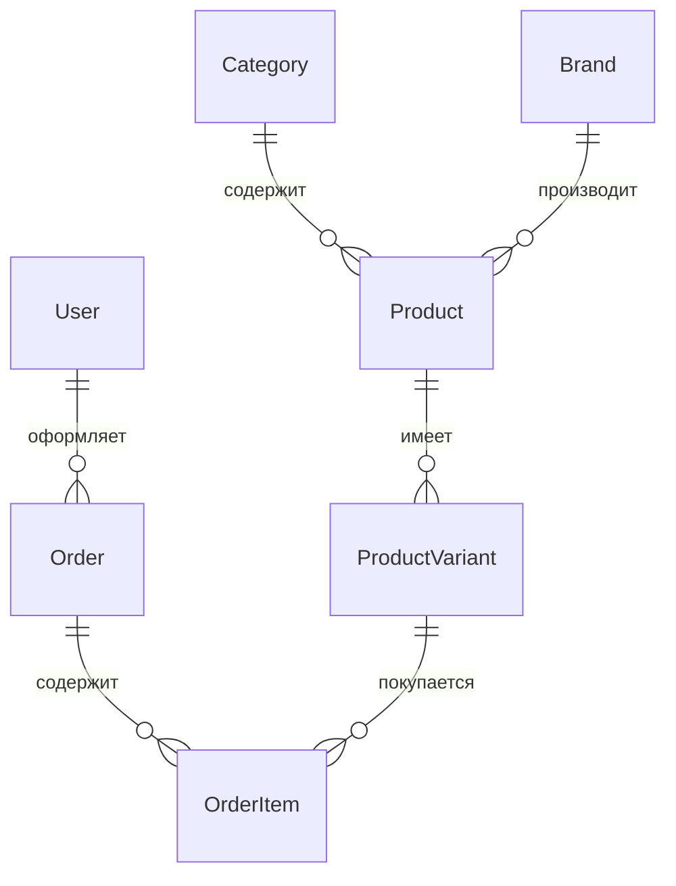

# Спортивный магазин — итоговое задание Д2–М4

## О проекте

Самостоятельный Django-магазин спортивных товаров на SQLite. Вариант **Д2–М4 предварительный**: по методичке староста сверяет шифры всей группы, а преподаватель утверждает итоговый вариант до первой контрольной точки. До подтверждения этот шифр нельзя считать официальным.

Покупатель может зарегистрироваться, найти товар, отфильтровать каталог по категории, бренду и доступному размеру, выбрать сортировку, открыть товар с фото, положить конкретный размер в корзину, оформить заказ, посмотреть историю и отменить новый заказ. Менеджер входит в `/admin/`, управляет товарами и остатками по размерам, подтверждает заказы и переводит их по допустимым статусам, открывает `/reports/` и выгружает CSV. Администратор управляет всеми данными.

Правило Д2: остаток хранится у `ProductVariant`; в корзину добавляется вариант определённого размера. Когда все размеры закончились, товар остаётся виден с надписью «Нет в наличии» без кнопки покупки. В заказе сохраняются размер, название и цена на момент оформления. Списание всех вариантов происходит в одной транзакции.

Модуль М4: отчёты только менеджерам и администраторам. Период проверяется формой, по умолчанию последние 30 дней. Выручка по дням и топ товаров исключают отменённые заказы; количество заказов по статусам включает все. Расчёты выполняются SQL-агрегатами. CSV доступен из той же формы.

## Модель данных



`Product` хранит цену, описание, фото, поисковый индекс и признак активности; `ProductVariant` — размер и остаток, с уникальностью пары товар–размер. `Order` хранит покупателя, получателя, адрес, телефон, статус и даты. `OrderItem` хранит вариант, снимок названия, размера, цены и количество. Ограничения БД проверяют положительную цену и количество, неотрицательный остаток и уникальность размера у товара.

## Запуск на Windows

Нужен Python 3.12 или новее. В PowerShell:

```powershell
cd final_project
py -3.12 -m venv .venv
.\.venv\Scripts\python.exe -m pip install -r requirements.txt
.\.venv\Scripts\python.exe manage.py migrate
.\.venv\Scripts\python.exe manage.py seed_demo
.\.venv\Scripts\python.exe manage.py runserver
```

Открыть http://127.0.0.1:8000/. Проверки:

```powershell
.\.venv\Scripts\python.exe manage.py check
.\.venv\Scripts\python.exe manage.py makemigrations --check --dry-run
.\.venv\Scripts\python.exe manage.py test
```

`seed_demo` создаёт 20 товаров, 46 вариантов размера, 4 бренда, категории и двух пользователей. Повторный запуск не создаёт дублей. Фото двух демонстрационных товаров копируются из `catalog/demo_images/` в `media/`; для остальных показывается заглушка. Фотографии созданы встроенным генератором изображений по запросам о беговых кроссовках и спортивной ветровке. Свои фото можно добавить через `/admin/`.

## Демонстрационные пользователи

- `buyer` / `ShopDemo-2026` — покупатель.
- `manager` / `ShopDemo-2026` — менеджер; `is_staff=True`, `is_superuser=False`, группа «Менеджеры» с ограниченными правами.
- Администратора создают командой `.\.venv\Scripts\python.exe manage.py createsuperuser`.

## Демонстрация преподавателю

1. Найдите «КРОССОВКИ», выберите бренд и размер, откройте товар. Термобельё `Base` демонстрирует полное отсутствие доступных размеров.
2. Под `buyer` добавьте два разных размера в корзину, оформите заказ и проверьте списание только выбранных вариантов.
3. В `/admin/` под `manager` переведите новый заказ в «Подтверждён», затем в «Передан в доставку». Попытка сразу отметить новый заказ выполненным не изменит его.
4. Откройте `/reports/`, выберите даты и выгрузите CSV. Под покупателем страница даёт 403.
5. Подставьте номер чужого заказа в адрес: ответ 404. Измените остаток после добавления в корзину и попробуйте оформить заказ: частичного списания не будет.

Демо-проект работает локально с `DEBUG=True`; перед публикацией потребуются отдельные производственные настройки.
